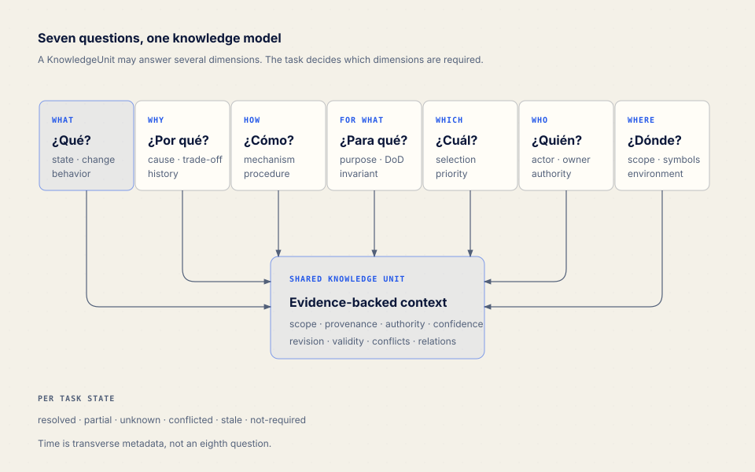
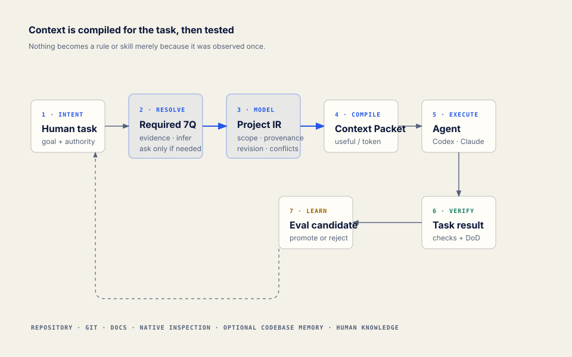
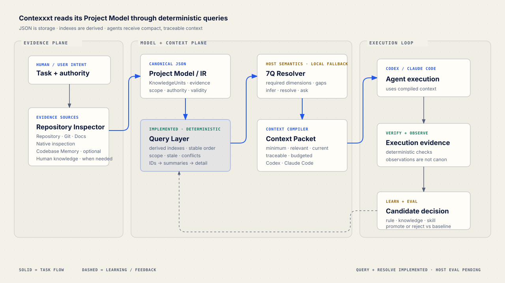

# contexxxt

**An adaptive context and behavior compiler for software agents.**

Agents rarely fail because they need a larger prompt. They fail because the relevant source is unclear, a decision lost its reason, a rule applies to the wrong scope, or stale context is presented as current truth.

contexxxt is evolving to enter a new or existing repository, gather evidence progressively, model what matters and compile the minimum context an agent needs for a specific task. What it learns may later become project knowledge, a validator, a procedure or a specialized skill — but only after evaluation against a baseline.

> Repository and evidence → Project Model / IR → deterministic queries → compiled agent context

## The thesis: seven questions

Every task may require some of seven context dimensions:

| Dimension | It resolves |
|---|---|
| **WHAT** · ¿Qué? | Current state, behavior, problem and requested change. |
| **WHY** · ¿Por qué? | Causes, decisions, constraints and trade-offs. |
| **HOW** · ¿Cómo? | Architecture, mechanisms, procedures and commands. |
| **FOR WHAT** · ¿Para qué? | Purpose, invariants and definition of done. |
| **WHICH** · ¿Cuál? | Applicable choice, source, strategy or priority. |
| **WHO** · ¿Quién? | Actor, owner, authority, consumer and audience. |
| **WHERE** · ¿Dónde? | Files, symbols, modules, services and environments. |

These are not seven questions the agent must ask a human. They are a coverage model. For each task, contexxxt should determine which dimensions matter, which are resolved by evidence, which can be inferred safely, and which are partial, unknown, conflicted or stale.

Time is transverse metadata — revision, observation, review, expiry and supersession — not an eighth question.



## How it should work



1. Receive normal human intent.
2. Determine the task, risk, scope and required 7Q dimensions.
3. Retrieve the smallest sufficient evidence set.
4. Resolve, infer, expose conflict or ask one high-value question.
5. Compile a revision-bound Context Packet for the target agent.
6. Let Codex or Claude Code execute and verify the result.
7. Treat what happened as observation, not immediate canon.
8. Evaluate any durable candidate against the no-contexxxt baseline.

The goal is to maximize **useful context / token**, not to preload the repository.

## Project Model, not Markdown as a database

The target architecture uses a structured Project Model as an intermediate representation. A shared knowledge unit can answer several 7Q dimensions and carries evidence, provenance, scope, authority, confidence, validity, revision binding, conflicts and relationships.

From that model contexxxt can eventually compile:

- Context Packets and handoffs;
- `AGENTS.md`, `CLAUDE.md` and project rules;
- references and documentation;
- deterministic validators;
- specialized skills and their evals.

Those outputs are projections. They must never become duplicate canonical stores.

The canonical JSON is storage, not agent context. The source version now exposes deterministic queries that build derived indexes and return IDs, summaries or selected detail under byte/item budgets:

```bash
contexxxt model validate
contexxxt query dimension why --view summary
contexxxt query knowledge contexxxt.model.self-reading
contexxxt context packages/cli/src/query/query.mjs --dimensions what,why,how,for_what,which,where
```

This gives the model progressive disclosure of its own knowledge: index first, specific unit second, raw evidence only when needed. **Contexxxt should not need to reread itself.** `context <target>` is deterministic; `resolve` now compiles a budgeted packet through an explicit local fallback or dimensions supplied by the host, not a claim of complete semantic understanding.

See [Project Model / 7Q IR](docs/PROJECT_MODEL.md).

## New project vs existing project

For an **existing project**, inspection comes first and is read-only. contexxxt should identify repository structure, Git revision, manifests, CI, tests, configs, docs, instructions and skills before proposing integration. User-owned files remain no-clobber and hash-aware.

For a **new project**, unknown history stays unknown. contexxxt should derive intent, constraints and definition of done from available artifacts and ask the human only where missing business knowledge materially changes the result.

## Native inspection and optional Codebase Memory

contexxxt must work by itself.

The Native Structural Provider uses filesystem, Git, manifests, configs, tests, CI, docs and instructions. It explicitly reports that symbol, caller, data-flow and impact coverage are incomplete. It is deliberately not a second code knowledge graph.

When [Codebase Memory](https://github.com/DeusData/codebase-memory-mcp) is available, the source adapter negotiates capabilities and normalizes architecture evidence while retaining provider, coverage and warnings. It accepts either the external read-only CLI transport or a snapshot delivered by a host MCP adapter. If the executable, capability, index or call is unavailable, contexxxt falls back to Native. Because the tested provider does not expose the indexed commit, its current evidence is marked `partial` rather than assumed fresh.

```text
without Codebase Memory: contexxxt works
with Codebase Memory:    contexxxt sees more structure
```

## Causal context without a Rationale dependency

The new core absorbs useful causal concepts explored in Rationale: decisions, constraints, options, consequences, provenance, evidence, authority, confidence, applicability, revision awareness, drift and bindings between decisions and governed code.

Rationale is not a runtime dependency and does not remain a separate source of truth. contexxxt also changes the approval philosophy: the system should resolve uncertainty through evidence, project knowledge or a safe reversible inference before asking a human. Authorization gates remain for production, publication, money, secrets, destructive changes and other externally consequential actions.

## The skill of skills

contexxxt should not generate a skill for every discovery.

A skill becomes a candidate only when:

- knowledge is stable and project-specific;
- a procedure repeats;
- contextual routing or specialization adds value;
- positive, negative and boundary cases can be evaluated;
- the candidate beats the baseline without unjustified context cost.

The correct outcome may be a short rule, a reference, a validator, a Context Packet — or nothing persistent. A generated `SKILL.md` should route and define workflow/contract; detailed material belongs behind progressive disclosure in `references/`, `scripts/`, `assets/` or `evals/`.

## How value will be demonstrated

At minimum, evaluation compares:

```text
baseline:  agent + repository
variant:   agent + repository + compiled context
candidate: variant + proposed rule / procedure / skill
```

The behavioral runner executes the same case as `baseline`, `context` and, when applicable, `candidate`. Context is compared with baseline; a candidate skill is compared with context-only so it cannot claim value already supplied by the ContextPacket. Provider-specific metrics remain separate instead of pretending Codex and Claude Code expose identical data. Its current scorer is deliberately narrow and term/evidence based; it is useful regression evidence, not a universal quality judge.

The current two-case Codex gate scored baseline `0.475`, ContextPacket `1.00`, and ContextPacket plus generated skill `1.00`. Context improved `+0.525` on this narrow suite; the skill added 2,918 context bytes without measured quality gain, so it remains unpromoted. Provider-reported token and duration costs remain in the EvalRun rather than becoming stable product claims. The equivalent Claude Code gate (Claude Code `2.1.251`, model `claude-sonnet-5`, 2026-08-29) produced the same scores on the same suite: baseline `0.475`, ContextPacket `1.00`, candidate `1.00`, with `0` execution errors. Claude reports token usage but not tool-call counts, which stay `null` instead of being estimated. These results support only this suite, host and model—not a general quality claim.

See [Evaluation strategy](docs/EVALUATION.md).

## Product status

### IMPLEMENTED · published npm package 0.1

- local Node.js CLI with `init`, `audit`, `doctor`, `add-space`, `sync`, `export`, `status` and `prompt`;
- idempotent, atomic and no-clobber managed-file writes;
- hash-based drift/conflict proposals;
- symlink and dangerous-target protections;
- current `.contextos/` template runtime;
- generic `context-os` skill and Codex/Claude Code adapters;
- CLI tests and repository content checks;
- npm package with a `contexxxt` binary.

### IMPLEMENTED · repository source 0.2.0-rc.1

- canonical Project Model JSON schema `1.1.0` and semantic validation;
- KnowledgeUnit identity, evidence references, 7Q coverage, typed scopes, validity, authority, confidence and relationships;
- regenerable in-memory indexes by ID, dimension, type, status, scope, evidence and relationship;
- deterministic `model validate`, `query`, `context` and query-eval commands;
- compact result views, stable ordering, provenance and item/byte budgets;
- fixtures and tests for lookup, multiple scopes, supersession, stale, conflicts, `not-required`, broken references, empty results, budgets and reproducibility;
- a dogfood Project Model at `.contexxxt/project-model.json` queried through the same public contract.
- read-only `inspect` with human/JSON output and explicit no-clobber report persistence;
- normalized Evidence from Git, filesystem, Node/pnpm manifests, package commands, GitHub Actions, tests, documentation, scoped agent instructions and existing contexxxt state;
- deterministic inspection fixtures for Node, monorepo, conflicting instructions, manifest-free and existing-model projects, plus dogfood inspection of this repository.
- `model build` from an explicit InspectionReport or an internal read-only inspection, with conservative KnowledgeUnit synthesis;
- idempotent reconciliation that preserves human knowledge, detects edits to generated units, emits proposals and never overwrites an invalid model;
- self-reading protection: canonical model storage is observed separately and is not fed back into its own generated snapshot.
- provider-neutral `resolve` with task-specific 7Q selection, explicit fallback strategy and host-directed dimension override;
- versioned TaskResolution and ContextPacket schemas with unknown/conflicted/stale handling, one high-value question, assumptions and verification requirements;
- byte/token budgets, inclusion rationale, omissions and stable packet identity;
- causal decision payloads and dogfood retrieval for the Query Layer/Resolver boundary.
- public `structural capabilities|inspect|compare` commands and a provider-neutral transport contract;
- always-available Native structural Evidence plus optional Codebase Memory CLI/host-snapshot adapters;
- capability negotiation, schema-valid provider provenance, explicit freshness gaps and deterministic Native fallback;
- measured dogfood comparison of Native against a host-delivered Codebase Memory snapshot, without converting structural breadth into a task-quality claim.
- versioned ExecutionObservation and LearningCandidate contracts that reject unstructured/secret-bearing inputs;
- `observe ingest`, `learning list|show|reject|promote|supersede`, and read-only `drift`;
- deterministic candidate deduplication, support thresholds and explicit eval-gated proposal promotion that never mutates the Project Model silently;
- dogfood observations produced one supported procedure candidate from two verified phases; it remains unpromoted.
- eval-gated skill synthesis from `supported` candidates, with thin `SKILL.md`, routing cases, manifest provenance, deterministic validation and correct rejection when a smaller artifact is preferable;
- behavioral `baseline` / `context` / `candidate` evaluation through real Codex and Claude Code host adapters, including execution-error preservation and provider-specific usage;
- minimal Codex/Claude Code retrieval adapters with digest-aware install, status, proposal and uninstall behavior;
- explicit `.contextos/` migration that preserves legacy input, validates the new model and records a report;
- second-repository dogfood on a 12-package application monorepo, which found and fixed a large-command-summary schema failure and generated-cache traversal.

### EXPERIMENTAL

- Markdown templates for project state, sources, decisions and handoffs;
- memory/project/space schemas from the 0.1 direction;
- behavioral scoring and the long-session protocol;
- fixed prompt/playbook exports.

### PLANNED · specified, not runtime behavior

- deeper file/symbol drift and semantic document ingestion;
- autonomous host orchestration around agent execution;
- broader behavioral datasets and a successfully authenticated Claude Code comparison.

The complete transition map is in [Audit and transition](docs/TRANSITION.md).

## Quickstart — what works today

Requires Node.js 22 or newer.

Run the published CLI without installing it globally:

```bash
npx contexxxt --help
npx contexxxt audit .
npx contexxxt init .
npx contexxxt doctor .
```

`audit` is read-only. `init` currently creates the legacy 0.1 `.contextos/` foundation; it does **not** yet build the Project Model described above. Run it only if that current behavior is useful to you.

Develop from this repository:

```bash
pnpm install
pnpm check
pnpm contexxxt help
pnpm contexxxt audit .
pnpm contexxxt inspect .
pnpm contexxxt inspect . --json
pnpm contexxxt model build --root .
pnpm contexxxt model validate --root .
pnpm contexxxt query dimension why --root . --view summary
pnpm contexxxt context packages/cli/src/query/query.mjs --root .
pnpm contexxxt resolve --target packages/cli/src/query/query.mjs --intent "Add a query filter" --root .
pnpm contexxxt skill validate .contexxxt/generated/skills/contexxxt-core-development
pnpm contexxxt eval behavioral evals/core-behavioral.json --host codex --variant baseline,context,candidate --max-cases 1 --output .contexxxt/evals/local.json
pnpm contexxxt agent status codex --root .
pnpm contexxxt migrate status --root .
```

The `0.2.0-rc.1` source has passed `npm pack`, clean tarball installation and `npx --no-install` smoke. The public registry separately serves `0.1.0`, and `npx contexxxt@0.1.0 version` succeeds. This does not mean the 0.2 alpha is published.

## Target architecture



The logical path is Project Model → deterministic Query Layer → semantic 7Q Resolver → Context Compiler. Around it sit the Repository Inspector, structural providers, execution/verification, observation/learning and eval promotion. They are responsibilities, not a promise to create a service per noun.

See [Architecture](docs/ARCHITECTURE.md) and the self-contained [architecture diagram](docs/diagrams/architecture.html).

## Repository today

```text
packages/cli/           published 0.1 CLI plus local 0.2 alpha source
packages/cli/src/model/ schema validation, identity and derived indexes
packages/cli/src/query/ deterministic retrieval and budgets
packages/cli/src/inspection/ read-only native inspection and normalized Evidence
packages/cli/src/evaluation/ deterministic and behavioral eval runners
packages/cli/src/learning/ observations, candidates, promotion proposals and drift
packages/cli/src/skills/ candidate skill compiler and validation
packages/cli/src/agents/ minimal host retrieval adapters
packages/cli/src/migration/ explicit legacy migration
packages/cli/schemas/   canonical Project Model schema
packages/cli/runtime/   current skill, adapters, agents and templates
.contexxxt/             dogfood Project Model for this repository
schemas/                current 0.1 JSON contracts
evals/                  static cases, protocol and scorecard
src/                    Astro landing and documentation site
docs/                   product foundation and transition design
docs/diagrams/          diagram-design HTML sources and SVG exports
```

Phase 0 changed the product foundation. Phases 1–9 now form a usable local core while preserving the legacy 0.1 runtime; release distribution and broader host evidence remain separate gates.

## Roadmap

1. **Foundation:** contract, 7Q model, architecture, transition, diagrams and honest README.
2. **Executable Project Model foundation:** schema, Query Layer and deterministic evals — implemented in source.
3. **Native inspect:** implemented in source; read-only evidence with revision, coverage and gaps.
4. **Project Model builder:** implemented in source; conservative, idempotent and proposal-based reconciliation.
5. **7Q resolver + compiler:** implemented with a deterministic provider-neutral fallback and host override.
6. **Optional Codebase Memory:** capability-negotiated structural acceleration — implemented in source; task-quality comparison remains pending.
7. **Observation/learning:** candidates without automatic promotion — implemented in source.
8. **Skill synthesis:** implemented for candidate bundles; the dogfood candidate was not promoted because it did not beat context alone.
9. **Behavioral eval/promotion:** implemented foundation and one measured Codex case; broader datasets remain.
10. **Cross-agent validation:** adapters implemented; Codex and Claude Code are both behaviorally measured on the same two-case suite.

Each phase defines objective, input, output, invariants, deterministic checks, evals and a completion gate in the [technical roadmap](docs/ROADMAP.md).

## Principles

- Progressive disclosure; context is finite.
- Evidence before assertions.
- Models decide; deterministic systems verify.
- Every source of truth is identifiable.
- No silent overwrite and no duplicate canon.
- Native operation; optional structural acceleration.
- No hidden Rationale or Codebase Memory dependency.
- Project-first, agent-first, local-first where practical.
- Codex and Claude Code are first-class, separately tested targets.
- No generated skill without justification.
- No quality claim without a baseline.
- Preserve useful existing work; prefer a smaller coherent system.

## Current limitations

- The local resolver is an explicit deterministic fallback, not a claim of full model-based semantic understanding. In the second-repo run it recovered structure and commands but not target-specific product intent from documentation bodies.
- The published 0.1 workflow still centers `.contextos/` and Markdown templates.
- “Everything passes through contexxxt” still needs host orchestration around actual editing and verification; current adapters teach retrieval and the eval runner isolates supplied context.
- The one positive Codex result is a narrow case, not proof of general improvement. The generated skill added cost without extra quality and remains unpromoted.
- Claude Code behavioral evidence comes from two clean, identical runs taken after fixing two runner defects that an earlier single clean run had hidden. It still covers two cases on one host version and one model. Both hosts reach `1.00` on the context variant, so the suite is saturated: it cannot detect a candidate skill that improves on an already-perfect context score, and the `0` skill delta is a ceiling effect as much as a measurement.
- The Claude host intermittently emits extra stdout after its JSON result, which contexxxt classifies as `invalid-host-output` rather than interpreting partial output. Observed once in roughly 25 executions; the behavioral gate can fail for this host-side reason.
- Direct CLI access to Codebase Memory 0.8.1 could not open the MCP server's active index during dogfood; the public adapter fell back to Native, while the host-snapshot path normalized the same MCP architecture successfully.
- The Codebase Memory comparison proves additional observed entry points, relation types and clusters, not improved task pass rate or ContextPacket quality.
- Native inspection is intentionally bounded: Node/pnpm and GitHub Actions receive structured parsing; other recognized manifests are currently presence evidence only.
- Inspection and model building are separate public contracts; the builder does not yet infer product intent or parse documentation bodies semantically.
- `.contextos/` migration is explicit and preserving, but the legacy runtime remains available throughout 0.2.x and removal is no earlier than 0.3.0.
- Drift detection is revision-only today; file/symbol bindings and provider-index freshness require deeper verification.
- JSON + derived in-memory indexes is the Phase 1 decision; SQLite has not been justified by measured need.

## Product documents

- [Product contract](docs/PRODUCT.md)
- [Project Model / 7Q IR](docs/PROJECT_MODEL.md)
- [Target architecture](docs/ARCHITECTURE.md)
- [Audit and transition](docs/TRANSITION.md)
- [Evaluation strategy](docs/EVALUATION.md)
- [Technical roadmap](docs/ROADMAP.md)
- [Release closure gate](docs/RELEASE.md)
- [Visual language](docs/DESIGN.md)

## Privacy and license

Personal configuration, accounts, private audits, real projects, transcripts and credentials stay outside this public repository. Examples must remain fictitious and neutral.

[MIT](LICENSE).
